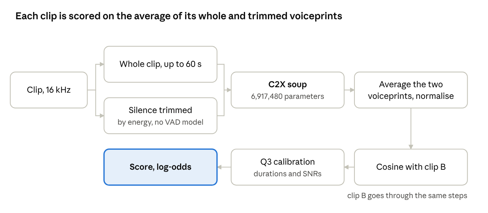

# SRED Technical Report: C2X Soup

Oct 24, 2026 · @Thuc.Tran · live version: https://claude.ai/artifact/F3DAPrgtVSUcURyW4YdB6r

## Summary

Our best system, C2X soup, is a 6,917,480-parameter ReDimNet2-B6 derivative. It cuts EER by about 0.2 against the submitted C2 + Q3 (private 5.6) on silver and real noise, and ties it on synthetic noise. It is two fine-tunes of the teammate's C2, both trained with shared-background pairs, averaged into one model. Clips are scored on the average of the whole-clip and energy-trimmed voiceprints, with the teammate's frozen Q3 calibration. Inference is non-transductive: each trial uses only its two clips.

| EER %, all trials / cleaned list | Silver | Silver, private-like weighting | Real noise | Synthetic noise |
| --- | --- | --- | --- | --- |
| C2 + Q3 (submitted, private 5.6) | 5.60 / 4.07 | 5.77 | 5.61 / 4.17 | 7.02 / 5.81 |
| **C2X soup + trimmed average + Q3** | **5.41 / 3.93** | **5.71** | **5.38 / 3.96** | 7.01 / 5.81 |

Private submission file: `submissions/final_private/result-private-S_C2X_X8-fv-q3.zip` (278,410 lines in the official order, all scores finite; `result-private-C2X-fv-q3.zip`, the first fine-tune alone, is the fallback).

## Pipeline



Each clip passes through the model twice, whole and trimmed. Only the averaged voiceprint and the clip's own duration and SNR reach the score.

## Model

The starting point is the teammate's C2: ReDimNet2-B6 (`b6-vb2+vox2+cnc2_v0-lm`) compressed to 6,917,480 parameters by low-rank factorisation of 14 projection layers, then distilled from a fine-tuned B6 teacher. It outputs a 192-d voiceprint from the whole clip (first 60 s). We fine-tuned C2 twice with the recipe below, changing only the seed and how often backgrounds are shared.

| Setting | Value |
| --- | --- |
| Training data | cleaned train list: 57,010 clips, 1,823 speakers |
| Crops | random 0.75 to 3 s per batch |
| Steps, batch | 8,000 steps, batch 16 (batch 32 runs out of memory on 20 GB) |
| Learning rate | backbone 1e-5, head 2e-3, 200 warm-up steps, 300 head-only steps; batch-norm statistics frozen; bf16 |
| Classification loss | SphereFace2, margin 0.2, scale 32; head initialised from C2's speaker centroids |
| Distillation | crop voiceprint matched to our B6 teacher's whole-clip voiceprint (cosine, weight 2.0) through a projection initialised by least squares, plus batch-similarity matching (weight 20) |
| Augmentation | noise (p 0.6, 5 to 20 dB), babble (13 to 20 dB), reverberation (0.3), band-limiting (0.2), EQ (0.3), mu-law (0.1) |
| Shared backgrounds | pairs of different speakers get the identical real background: p 0.5 (run 1, seed 0) and 0.8 (run 3, seed 2) |
| Averaging | each run averaged 50/50 with C2, then the two results averaged 50/50 |

The averages keep the architecture, so the soup has the same 6,917,480 parameters as C2.

## Scoring

Each clip gets one voiceprint: the normalised sum of two normalised embeddings, the whole clip and the clip with silence trimmed by energy (no VAD model). Trimming keeps a 15-frame margin around speech and at least 1 s of audio (`sred.embed.vad_trim`). Clips are scored by cosine similarity, which the teammate's frozen Q3 maps to log-odds:

```latex
\text{score} = w^\top \frac{x-\mu}{\sigma} + b,\quad x = [s,\ \ell_{\min},\ \ell_{\max},\ s\ell_{\min},\ s\ell_{\max},\ q_{\min},\ q_{\max},\ s q_{\min},\ s q_{\max}]
```

Here s is the cosine, the l terms are the log durations of the shorter and longer clip, and the q terms are their SNR estimates (95th minus 10th percentile of frame energy, clipped to −5 to 40 dB, divided by 10). Q3 was fitted only on train pairs and is not refitted. A refit on our own cohort scored 0.08 worse, and the trimmed average with the frozen Q3 adds 0.05 to 0.1 on every stand-in.

## Results and ablation

Shared backgrounds are what make fine-tuning help: without them the fine-tune is worse than C2, and with them it beats C2 on silver and real noise. All rows use the frozen Q3; EER %, all trials / cleaned list.

| System | Silver | Silver, private-like | Real noise | Synthetic |
| --- | --- | --- | --- | --- |
| C2, whole clip (submitted) | 5.60 / 4.07 | 5.77 | 5.61 / 4.17 | 7.02 / 5.81 |
| C2, trimmed average | 5.56 / 4.05 | 5.76 | 5.53 / 4.13 | **6.93 / 5.69** |
| Run 1 (shared 0.5), whole clip | 5.48 / 4.01 | 5.71 | 5.51 / 4.12 | 7.10 / 5.94 |
| Run 1, trimmed average | **5.41 / 3.93** | 5.76 | 5.39 / 4.00 | 6.97 / 5.77 |
| Run 2 (no shared backgrounds), trimmed average | 5.63 / 4.18 | 6.04 | not run | not run |
| Run 3 (shared 0.8), trimmed average | 5.45 / 3.95 | 5.74 | not run | not run |
| Runs 1 + 2 averaged, trimmed average | 5.47 / 4.00 | 5.83 | not run | not run |
| **Runs 1 + 3 averaged, trimmed average (best)** | **5.41 / 3.93** | **5.71** | **5.38 / 3.96** | 7.01 / 5.81 |

Rejected on silver for C2 (all trials): TTA views with mean score 5.89, a calibration refit 5.68, train-cohort score normalisation 5.89. On synthetic noise the fine-tuned models trail the trimmed C2 by 0.04 to 0.08; our earlier X2 model showed the same pattern, and the real-noise stand-in is the one spectrally closest to private.

## Data and evaluation

Training uses the official train set only. Every number above comes from noisy versions of the public test, because private labels are hidden and private is about 10 dB noisier than public.

- **Train:** 58,404 clips, 1,900 speakers, 146 h. Cleaning merges duplicate identities and drops bad files: 57,010 clips, 1,823 speakers.
- **Silver set:** public audio plus loop-free real background cut from train recordings (median SNR 12.5 dB), plus a low-frequency rumble on 30% of clips. 49,993 trials; the cleaned list drops 2,061 mislabelled ones. Published on HF `pieceofcakee/vlsp2026`, folder `silver/`, with `evaluate_silver.py`.
- **Private-like weighting:** silver's different-speaker trials re-weighted to private's mix of channel gap, SNR gap and gender match, because private impostors share recording conditions.
- **Real noise:** public plus real background noise from train recordings, the stand-in spectrally closest to private.
- **Synthetic noise:** public plus synthetic noise at private's SNR; it predicted an earlier model's private score within 0.01.

A change is kept only if it beats the reference on silver (all trials and cleaned list), on the private-like weighting and on real noise. The metric is EER, so only the ranking of scores matters.

## Compliance and reproduction

The system meets the known rules; two items still need the organisers' confirmation.

- [x] Under 7M parameters: 6,917,480 weights in one model.
- [x] Non-transductive: each trial is scored from its own two clips; no clustering or smoothing over test files.
- [x] No VAD model: trimming is energy-based.
- [x] Training on the official train set only; calibration fitted on train only.
- [ ] The checkpoint also stores fixed STFT/mel buffers: confirm the organisers count only weights.
- [ ] The B6 starting weights come from the OpenASR fp16 pack: compare with PalabraAI's release if the rules name a file.

To rebuild the private zip from the SRED folder:

```bash
source env.sh
# 1. fine-tunes (sred/train.py with base c2; flags in exp/overnight/chain2.sh and chain_c2x8.sh)
# 2. 50/50 averages
python scripts/wise_interp.py exp/ft/C2X_shared/last.pt exp/ft/W_C2X_shared/avg.pt --alpha 0.5
python scripts/wise_interp.py exp/ft/C2X8_shared/last.pt exp/ft/W_C2X8_shared/avg.pt --alpha 0.5
python scripts/soup.py exp/ft/S_C2X_X8/avg.pt exp/ft/W_C2X_shared/avg.pt exp/ft/W_C2X8_shared/avg.pt --alpha 1.0
# 3. private embeddings (whole clip + energy-trimmed) and the zip
python scripts/c2_embed_all.py --model exp/ft/S_C2X_X8/avg.pt --tag S_C2X_X8 --no-tta --split private
python scripts/c2_q3_zip.py --tag S_C2X_X8 --variant fv --zip result-private-S_C2X_X8-fv-q3.zip
```

The C2 code and weights come from the teammate's package, loaded weights-only (`sred/models.py`, model name `c2`). Evaluation: `scripts/c2_q3_eval.py --tag S_C2X_X8 --splits silver public_realnoise public_noisy`.

## Limitations and next steps

The gain is about 0.2 EER, so the system is unlikely to reach 5.0 on private by itself. Short speech remains the largest error source.

- **Short clips:** trials whose shorter clip has under 1 s of speech hold about a third of all errors (EER near 11 for C2). Calibration cannot fix them; a duration-aware training objective is the next experiment.
- **Synthetic noise:** the fine-tuned models trail the trimmed C2 there. Private's spectrum is closer to the real-noise set, which they win.
- **Rules-dependent levers:** a self-supervised (WavLM-type) teacher and training on the labelled public test could add more than any tweak, if the organisers allow them.
- **Stand-ins are public audio:** every number comes from the public speakers with added noise, so the private gain may differ.
