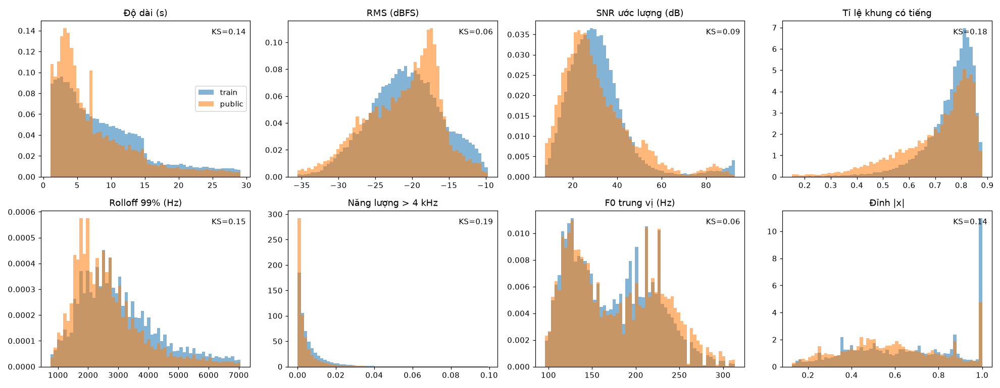
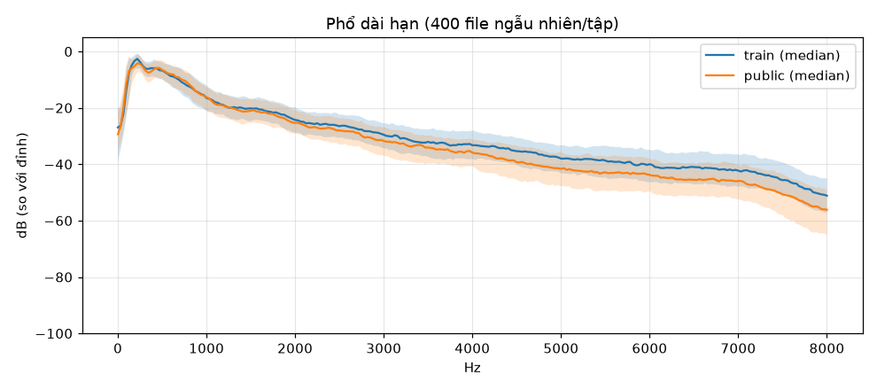
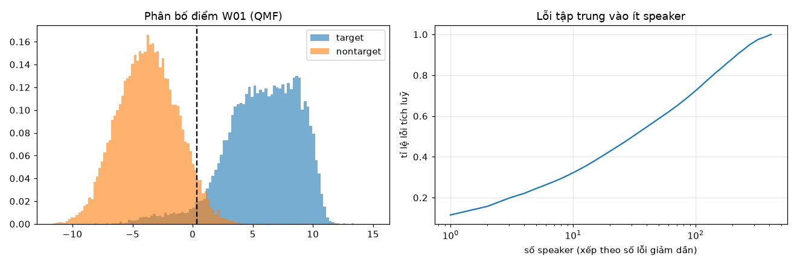
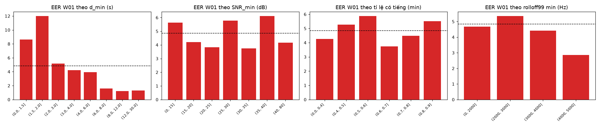
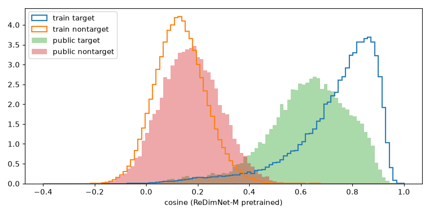
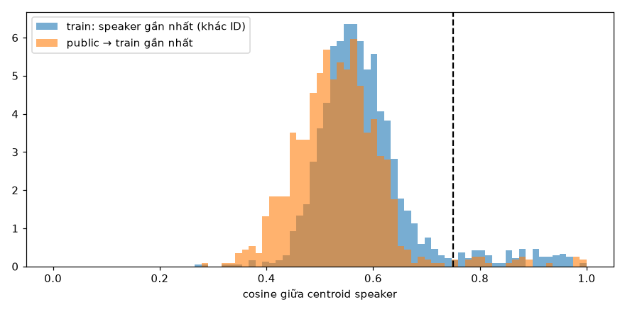

# EDA — dữ liệu train và public test (VLSP 2026 Vi-SRED26)

Ngày: 14/10/2026 · Hệ thống tham chiếu khi phân tích lỗi: **W01** (`releases/version_141026_W01`, EER public 4.85 %).

Mục tiêu của EDA này không phải để mô tả dữ liệu cho đẹp mà để trả lời: **cái gì đang gây lỗi, dữ liệu có vấn đề gì,
và nên làm gì tiếp theo**. Mỗi mục kết thúc bằng phần *Hệ quả* cho mô hình.

---

## 0. Tóm tắt (đọc phần này nếu không có thời gian)

| # | Phát hiện | Mức độ | Hệ quả |
|---|---|---|---|
| 1 | **Khoảng 7 % ID trong public chứa hai giọng khác hẳn nhau** (42/568 ID). Target trial của các ID này chiếm 6.9 % số target nhưng gây **39 % số lần bỏ sót** (tỉ lệ bỏ sót 27 % so với 3.2 %). Ở các ID nặng nhất, F0 của hai cụm lệch nhau khoảng 100 Hz. | ★★★ | Một phần lớn lỗi có thể **không sửa được** bằng cách cải thiện model, vì nhãn test có thể sai. Hiện tượng tương tự có trong train (56 ID, 4.6 % số câu), tức train cũng có nhãn nhiễu. |
| 2 | **Public bị một speaker chi phối.** id03289 chiếm 29.5 % target trial (7.378/25.000). Top-10 speaker chiếm 33 % tổng trial và 32 % số lỗi. Chỉ 393/902 speaker có target trial. | ★★★ | EER public phản ánh rất ít speaker, nên private có thể khác xa. Không nên tối ưu chi li trên public. |
| 3 | **Lỗi do câu ngắn.** Cặp có file ngắn nhất dưới 3 s chiếm 57 % số lỗi (EER 5–12 %). Khi cả hai file trên 6 s, EER chỉ 1.2–1.6 %. | ★★★ | Đây là đòn bẩy lớn nhất: cải thiện xử lý câu ngắn (train với crop ngắn, calibration theo độ dài). |
| 4 | **Biến thiên giữa các phiên ghi âm (session).** Với cùng một người, tỉ lệ bỏ sót là 2.6 % khi hai file có số thứ tự liền nhau và tăng lên 6 % khi cách xa nhau. | ★★ | Điểm yếu là thay đổi theo thời gian/kênh, không phải nhiễu tổng hợp. |
| 5 | **Giới tính.** Cặp khác người cùng giới bị nhận nhầm 6.9 %, khác giới chỉ 1.7 %. Public cố ý ghép cặp cùng giới nhiều hơn ngẫu nhiên (61 % so với 52 %). | ★★ | Có thể khai thác thông tin giới tính như một đặc trưng phụ trong calibration. |
| 6 | **Train mất cân bằng nặng.** 10 % speaker chiếm 45 % số câu (67 giờ); 373 speaker có không quá 5 câu. | ★★ | Thử lấy mẫu cân bằng theo speaker, hoặc giới hạn số câu tối đa mỗi speaker. |
| 7 | **Domain public lệch nhẹ so với train:** nhiều im lặng hơn (11.6 % file có hơn nửa thời lượng là im lặng, train 2.9 %), câu ngắn hơn, SNR thấp hơn một chút, ít năng lượng tần cao hơn. Độ lệch nhỏ (KS ≤ 0.19). | ★ | Augmentation nhiễu/kênh mạnh **không có cơ sở**; nên thử VAD hoặc cắt im lặng. |
| 8 | **Không có rò rỉ lớn.** Có 3 file audio trùng hệt giữa train và public (một cặp ID). Khoảng 5 speaker public gần như chắc chắn trùng người với một speaker train (cosine giữa tâm ≥ 0.98). Độ dài cặp không dự đoán được nhãn (AUC ≈ 0.5). | ★ | Kết quả public không bị thổi phồng đáng kể. Nên báo BTC về các cặp trùng. |
| 9 | **Giả thuyết đã bác bỏ:** audio *không* phải băng hẹp kiểu điện thoại (phổ không có vết cắt ở 4 kHz); speaker "hub" (gần nhiều người khác) *không* bị nhận nhầm nhiều hơn. | – | Tránh đi sai hướng. |

---

## 1. Dữ liệu và phương pháp

| | Train | Public test |
|---|---|---|
| Số câu / file | 58.404 | 17.850 |
| Speaker | 1.900 | 902 |
| Tổng thời lượng | 145.9 giờ | 37.3 giờ |
| Định dạng | WAV 16 kHz mono (100 %) | WAV 16 kHz mono (100 %) |
| Trial | – | 49.993 (50.0 % target), không trùng lặp, không có cặp tự so với chính nó |

Công cụ (thư mục `eda/`, kết quả trong `eda/out/`, hình trong `docs/eda_figs/`):

- `eda/audio_stats.py`: tính đặc trưng âm học cho từng file (76.254 file). Gồm độ dài, RMS, đỉnh, clipping,
  tỉ lệ khung có tiếng (ngưỡng năng lượng), im lặng đầu/cuối, SNR ước lượng (p95 − p10 năng lượng khung),
  rolloff 99 %, năng lượng trên 4 kHz và 7 kHz, F0 (tự tương quan, 50–400 Hz).
- `eda/analyze_audio.py`: so sánh domain, suy ra giới tính, phân tích lỗi của W01 theo từng yếu tố.
- `eda/extract_train_emb.py` và `eda/analyze_emb.py`: embedding của **ReDimNet-M pretrained** (chưa từng thấy
  nhãn VLSP) cho toàn bộ train và public, dùng để tìm nhãn nhiễu, ID trùng danh tính, file trùng và hub.
- Giới tính suy từ F0 trung vị của từng speaker (ngưỡng 165 Hz). Đây là xấp xỉ thô, chỉ dùng để phân tích.

> Tên thư mục của public chứa ID speaker. ID này **chỉ** được dùng để phân tích, không đưa vào hệ thống.

---

## 2. Cấu trúc tập train

**Độ dài câu:** p5 = 1.6 s, trung vị 7.4 s, p95 = 23.6 s, dài nhất 30 s. Có 8.9 % câu dưới 2 s và 27 % dưới 4 s.

**Số câu mỗi speaker rất lệch:**

| Chỉ số | Giá trị |
|---|---|
| Câu/speaker: min / p10 / trung vị / p90 / max | 1 / 4 / 11 / 68 / 577 |
| Phút/speaker: p10 / trung vị / p90 | 0.4 / 1.4 / 11.3 |
| 1 % speaker nhiều dữ liệu nhất (19 người) | 12.4 % số câu |
| 10 % speaker nhiều dữ liệu nhất (190 người) | 45.3 % số câu (66.7 / 145.9 giờ) |
| 50 % speaker ít dữ liệu nhất | 10.3 % số câu |
| Speaker có ≤ 3 / ≤ 5 / ≥ 100 câu | 122 / 373 / 83 |

Tên file (`idXXXXX/NNNN.wav`) có chỉ số lên tới 2.822, trong khi trung vị của chỉ số lớn nhất mỗi speaker là 64.
Điều này cho thấy train là một **tập con được lấy mẫu từ một kho lớn hơn**, và chỉ số file phản ánh thứ tự thời
gian hoặc phiên ghi âm (xem §5.4).

Giới tính: 53 % speaker là nam, nhưng tính theo số câu thì nữ 50.5 % và nam 49.5 %, khá cân bằng.

**Hệ quả:**
- Với sampler hiện tại (theo câu), gradient bị 190 speaker lớn chi phối. Ngược lại, 373 speaker ≤ 5 câu gần như
  chỉ giúp head AAM học thêm lớp chứ đóng góp ít cho việc học biến thiên trong cùng một người.
- Nên thử `--spk-balanced`, hoặc giới hạn số câu mỗi speaker ở mỗi epoch.

---

## 3. Cấu trúc public test và các trial

**File:** trung vị 5.4 s (ngắn hơn train, vốn có trung vị 7.4 s). 10 % file dưới 2 s, **36 % dưới 4 s** (train 27 %).
Số file mỗi speaker: trung vị 12, p90 = 46, lớn nhất 603.

**Trial không cân bằng giữa các speaker:**

| Chỉ số | Giá trị |
|---|---|
| Số speaker có ít nhất một target trial | **393 / 902** |
| Target trial của speaker id03289 | **7.378 / 25.000 = 29.5 %** (515 file) |
| Target trial của top-5 speaker | 34.8 % |
| Tổng trial của top-10 / top-50 speaker (theo file thứ nhất) | 32.7 % / 68.3 % |
| Số trial mỗi file: trung vị / p90 / max | 2 / 13 / 176 |

**Có rò rỉ nhãn qua cách thiết kế trial không? Không.**

| Đặc trưng của cặp | AUC dự đoán nhãn target |
|---|---|
| d_min | 0.505 |
| d_max | 0.493 |
| \|d_a − d_b\| | 0.476 |
| d_min / d_max | 0.527 |

Độ dài không mang thông tin về nhãn, nên QMF theo độ dài không khai thác lỗ hổng mà chỉ hiệu chỉnh độ tin cậy.

**Ghép cặp nontarget có thiên lệch giới tính:** 61.0 % cặp nontarget là cùng giới, trong khi nếu ghép ngẫu nhiên thì
chỉ khoảng 51.6 %. Ban tổ chức có vẻ chủ ý tạo cặp khó.

**Hệ quả:**
- EER trên public là trung bình có trọng số cực lệch: một người chiếm gần 30 % target.
- Bỏ riêng id03289 thì EER = 4.60 %; chỉ tính id03289 thì EER = 4.25 %; gộp tất cả lại là 4.85 %. Gộp làm EER tăng vì
  thang điểm của các speaker khác nhau, nên khó chọn một ngưỡng chung.
- Private test nhiều khả năng có cấu trúc tương tự (một vài speaker chiếm phần lớn) nhưng với người khác. Vì vậy
  **phương sai giữa public và private rất lớn**; phân tích bootstrap trước đây cho dao động trên 1 điểm EER.

---

## 4. So sánh domain giữa train và public

| Đặc trưng (trung vị; p10–p90) | Train | Public | KS |
|---|---|---|---|
| Độ dài (s) | 7.36 (2.1–18.8) | 5.37 (2.0–16.0) | 0.14 |
| RMS (dBFS) | −20.8 | −20.4 | 0.06 |
| SNR ước lượng (dB) | 29.5 (16.7–46.5) | 27.0 (14.1–51.9) | 0.09 |
| Tỉ lệ khung có tiếng | 0.78 (0.63–0.85) | 0.75 (**0.48**–0.84) | **0.18** |
| Năng lượng > 4 kHz | 0.40 % | 0.20 % | **0.19** |
| Rolloff 99 % (Hz) | 2.781 | 2.406 | 0.15 |
| F0 (Hz) | 170 | 172 | 0.06 |
| Đỉnh \|x\| | 0.64 | 0.56 | 0.14 |

Các cờ chất lượng (tỉ lệ file):

| Cờ | Train | Public |
|---|---|---|
| Clipping (> 0.01 % mẫu ở ±1) | **10.7 %** | 3.2 % |
| SNR ước lượng < 15 dB | 6.7 % | **11.9 %** |
| Hơn 50 % thời lượng là im lặng | 2.9 % | **11.6 %** |
| Im lặng đầu file > 1 s | 0.2 % | **2.9 %** |
| Mức âm rất thấp (< −40 dBFS) | 0.07 % | 0.14 % |
| Sample rate khác 16 kHz | 0 | 0 |

**Phổ dài hạn: audio không phải băng hẹp.**

Rolloff 99 % thấp (trung vị khoảng 2.4–2.8 kHz) ban đầu gợi ý audio điện thoại 8 kHz được upsample. Kiểm tra trực
tiếp trên 400 file ngẫu nhiên mỗi tập cho thấy độ sụt năng lượng quanh 4 kHz chỉ khoảng 2 dB (trung vị), và chỉ
0–1 % file sụt hơn 20 dB. Vậy dữ liệu **là băng rộng**; rolloff thấp chỉ do giọng nói dồn năng lượng ở dải tần
thấp. Có 4.5 % file public (so với 0.5 % train) có vết cắt quanh 7 kHz, có thể do codec nén.

**Hệ quả:**
- Độ lệch domain **nhẹ**. Augmentation hiện tại gồm giới hạn băng 3–4 kHz (xác suất 0.2), μ-law (0.1), và vang với
  RT60 tới 0.9 s (0.3). Các điều kiện này **không xuất hiện** trong dữ liệu thật, nên kéo phân bố train ra xa test.
  Nên làm ablation (§8).
- Public có nhiều im lặng và im lặng đầu file hơn hẳn train. Hai hướng đáng thử: VAD hoặc cắt im lặng khi suy luận,
  và augmentation chèn im lặng khi train.
- Train có nhiều file bị clipping (10.7 %) hơn public (3.2 %).

---

## 5. Phân tích lỗi của W01 trên public

Ngưỡng EER bằng 0.36 (log-odds), cho ra 2.423 lỗi. Phân bố điểm target có **một đuôi dài lấn sang vùng nontarget**
(khoảng −8 đến 0). Đây là dấu hiệu của các target trial "không giống người", xem §6.1.

### 5.1 Theo độ dài (file ngắn hơn của cặp)

| d_min | ≤ 1.5 s | 1.5–2 s | 2–3 s | 3–4 s | 4–6 s | 6–8 s | 8–12 s | > 12 s |
|---|---|---|---|---|---|---|---|---|
| Số trial | 4.505 | 4.490 | 10.681 | 10.902 | 8.476 | 5.728 | 3.572 | 1.639 |
| EER (%) | 8.6 | **12.0** | 5.2 | 4.2 | 3.9 | 1.6 | 1.2 | 1.3 |
| Tỉ trọng lỗi | 16 % | 18 % | 23 % | 21 % | 15 % | 4 % | 2 % | 1 % |

Với d_min < 3 s, cặp chiếm 39 % số trial nhưng **57 % số lỗi**. Khi d_min > 6 s, bài toán gần như đã được giải.

### 5.2 Theo SNR, tỉ lệ có tiếng và băng thông

EER **không biến thiên đơn điệu** theo SNR ước lượng (5.6 / 4.2 / 3.8 / 5.8 / 3.7 / 6.1 / 4.2 % qua các khoảng
từ < 15 dB đến > 40 dB), theo tỉ lệ khung có tiếng, hay theo rolloff. Theo RMS thì có một xu hướng: file nhỏ tiếng
(< −35 dBFS) có EER 6.8–12 %, file lớn hơn −25 dBFS có 3.9–4.3 %. Cần lưu ý SNR ở đây là ước lượng thô từ dải động
năng lượng; dù vậy, đến mức này thì **nhiễu không phải yếu tố chính** gây lỗi.

### 5.3 Theo giới tính

| | Giá trị |
|---|---|
| Tỉ lệ nhận nhầm trong cặp nontarget cùng giới | **6.9 %** |
| Tỉ lệ nhận nhầm trong cặp nontarget khác giới | 1.7 % |
| EER khi chỉ giữ nontarget cùng giới | 5.39 % (so với 4.85 % trên toàn bộ) |
| Tỉ lệ bỏ sót target: nam / nữ | 4.7 % / 5.0 % |

### 5.4 Theo khoảng cách chỉ số file (xấp xỉ khác phiên)

Chỉ xét target trial, khoảng cách = |chỉ số file a − chỉ số file b|:

| Khoảng cách | 1 | 2–3 | 4–10 | 11–30 | 31–100 | > 100 |
|---|---|---|---|---|---|---|
| Số trial | 1.508 | 2.495 | 6.008 | 6.021 | 3.377 | 5.591 |
| Tỉ lệ bỏ sót | **2.6 %** | 3.3 % | 3.9 % | 5.3 % | **6.1 %** | 5.9 % |

Hai câu ghi gần nhau (nhiều khả năng cùng phiên, cùng micro) dễ hơn gấp đôi so với hai câu ghi cách xa nhau.

### 5.5 Theo speaker

- 413/902 speaker có ít nhất một lỗi, nhưng **top-10 speaker gây 32 % số lỗi**.
- Trong số 149 speaker có ít nhất 30 target trial: tỉ lệ bỏ sót trung vị là **0 %**, p90 là 12 %, cao nhất là 48 %.

| Speaker | Lỗi / trial | Loại lỗi chính |
|---|---|---|
| id03289 (F) | 419 / 7.561 | bỏ sót 5.7 % (có nhiều trial) |
| id04411 (F*) | 153 / 577 | **bỏ sót 47.7 %** |
| id02686 (M*) | 146 / 490 | **bỏ sót 31.2 %** |
| id02134 (F) | 86 / 980 | nhận nhầm 9.4 % |
| id00223 (F) | 85 / 1.210 | nhận nhầm 7.6 % |

\* ID có hai cụm giọng, xem §6.1.

**Hệ quả:** lỗi tập trung mạnh theo speaker. Một phần lớn đến từ một số ID có tỉ lệ bỏ sót cực cao, không phải từ
việc model yếu đều trên mọi người.

---

## 6. Phân tích trong không gian embedding (ReDimNet-M pretrained)

| | Train (cặp tổng hợp) | Public (trial thật) |
|---|---|---|
| EER cosine | 3.43 % * | 5.87 % |
| Cosine trung vị của target | 0.78 | **0.64** |
| Cosine trung vị của nontarget | 0.13 | 0.17 |

\* Target trên train được ghép giữa các câu liền kề của cùng speaker (thường cùng phiên), nên dễ hơn. Ngay cả khi
tính đến điều đó, target trên public "khó" hơn rõ: cosine trung vị thấp hơn 0.14.

### 6.1 ID chứa hai giọng: nhãn nhiễu (phát hiện quan trọng nhất)

Với mỗi speaker có ít nhất 8 file, chia embedding thành 2 cụm bằng k-means. ID được coi là **có hai cụm** nếu cosine
giữa hai tâm cụm nhỏ hơn 0.5 và cụm nhỏ chiếm ít nhất 15 % số file.

| | Train | Public |
|---|---|---|
| ID có hai cụm | 56 / 1.270 (4.4 %) | **42 / 568 (7.4 %)** |
| Số câu thuộc các ID này | 2.708 (4.6 % train) | – |
| ID có hai cụm lệch F0 trên 60 Hz (gợi ý một nam, một nữ) | 20 | (ví dụ bên dưới) |

Ảnh hưởng lên public:

| | Target trial của ID có hai cụm | Các target trial còn lại |
|---|---|---|
| Tỉ trọng trong số target | 6.9 % | 93.1 % |
| Tỉ lệ bỏ sót của W01 | **27.3 %** | 3.2 % |
| Tỉ trọng trong tổng số lần bỏ sót | **38.9 %** | 61.1 % |

Ví dụ:
- **id04411:** cụm A có 23 file, F0 258 Hz; cụm B có 31 file, F0 150 Hz.
- **id02686:** cụm A có 48 file, F0 137 Hz; cụm B có 34 file, F0 227 Hz.
- Ở cả hai, SNR, mức âm và băng thông giữa hai cụm gần như giống nhau. Nghĩa là khác biệt nằm ở **giọng người**,
  không phải ở kênh truyền.

**Diễn giải.** Nhiều khả năng các ID này gộp hai người khác nhau, ví dụ đoạn hội thoại có người phỏng vấn, hoặc lỗi
gán nhãn. Cũng có thể là một người với hai điều kiện rất khác nhau, nhưng với F0 lệch khoảng 100 Hz thì khả năng
này thấp.

**Hệ quả:**
1. Khoảng 39 % số lần bỏ sót trên public có thể **không sửa được**, vì chúng là cặp "target" giữa hai giọng khác
   nhau. Trần EER thực tế cao hơn 0.
2. Train cũng có khoảng 4.6 % câu thuộc các ID có hai cụm. Khi train với AAM, model bị ép kéo hai giọng khác nhau
   về cùng một lớp, đúng là kiểu nhiễu nhãn có hại. **Làm sạch** các ID này (tách cụm, hoặc bỏ cụm nhỏ) là một thí
   nghiệm rẻ và có cơ sở. Sub-center AAM (K = 3) đã giảm nhẹ một phần vấn đề này.
3. Danh sách chi tiết: `eda/out/public_spk_bimodality.csv`, `eda/out/train_spk_bimodality.csv`.

### 6.2 Câu có nhãn đáng ngờ trong train

Câu bị coi là đáng ngờ nếu cosine tới tâm của chính speaker đó (đã loại câu này ra khi tính tâm) nhỏ hơn 0.35,
và thấp hơn cosine tới tâm của một speaker khác ít nhất 0.1.

- Có **446 câu (0.76 %)**, thuộc 15 speaker có ít nhất 20 % số câu đáng ngờ.
- Các câu này ngắn hơn rõ rệt: trung vị 2.3 s, so với 7.4 s của toàn tập; 41 % dưới 2 s. Một phần là do câu ngắn
  cho embedding nhiễu, không hẳn là nhãn sai.
- Danh sách: `eda/out/train_suspicious_labels.csv`.

### 6.3 Trùng danh tính và file trùng

ID được coi là trùng danh tính khi cosine giữa tâm hai speaker lớn hơn 0.75. Cosine tới speaker gần nhất trong
train: trung vị 0.57, p99 = 0.94.

| Loại | Số cặp vượt ngưỡng |
|---|---|
| train – train | 236 cặp, gom thành 33 nhóm; nhóm lớn nhất có 36 ID |
| public – public | 30 cặp |
| public – train | 51 cặp (25 speaker public) |

Kiểm chứng ở mức file cho các cặp public–train:
- Cặp có tâm gần như trùng (cosine ≥ 0.98): id04115↔id02565, id01001↔id01208, id03124↔id01947, id00047↔id01687,
  id04410↔id03859. Đây gần như chắc chắn là **cùng một người** mang ID khác nhau giữa train và public. Một số file
  của họ có cosine trên 0.97.
- **3 file audio trùng hệt bit-for-bit** giữa id02623 (public) và id02625 (train).
- Các trial chạm tới những speaker public có file trùng gần như hoàn toàn: 320 trial (0.6 %).
- Trong train có 186 cặp câu gần như trùng (cosine > 0.97), trong đó 49 cặp thuộc hai ID khác nhau. Đây vừa là
  file lặp, vừa là nhãn nhiễu.
- Nhóm 36 ID trong train nhiều khả năng *không* phải 36 bản sao của một người. Đây có lẽ là các speaker có giọng
  giống nhau, nối với nhau thành chuỗi khi dùng ngưỡng 0.75. Điều này chưa được kiểm chứng ở mức file.

**Hệ quả:** rò rỉ từ train sang public rất nhỏ (dưới 1 % trial), không làm phồng EER đáng kể. Nên báo BTC về 3 file
trùng và khoảng 5 cặp ID trùng người. Trong train, có thể gộp các ID trùng người (cosine ≥ 0.9) để AAM không bị ép
tách cùng một người thành hai lớp.

### 6.4 Speaker "hub": giả thuyết bị bác bỏ

Một số speaker public (id02686, id02570) gần với 10–19 tâm speaker train. Giả thuyết ban đầu là các speaker hub dễ
bị nhận nhầm. Kết quả ngược lại: tương quan Spearman giữa độ hub và tỉ lệ nhận nhầm là −0.18 (487 speaker). Các
speaker hub nằm trong top lỗi vì **bỏ sót**, và chính là những ID có hai cụm ở §6.1: tâm của một ID lẫn hai giọng
rơi vào giữa không gian, nên gần nhiều người khác.

---

## 7. Hệ quả tổng hợp cho bài toán

1. **Trần EER trên public bị nhiễu nhãn kéo lên.** Ước lượng thô: nếu bỏ các target trial thuộc ID có hai cụm, số
   lần bỏ sót giảm khoảng 39 %. Đừng diễn giải mọi cải thiện hay suy giảm cỡ 0.1–0.3 trên public là có ý nghĩa.
2. **Câu ngắn là chỗ cần cải thiện thật sự.** d_min < 3 s gây 57 % số lỗi. Các hướng phù hợp: crop ngắn hơn khi train
   (1–2 s), calibration theo độ dài (đã có QMF), và nếu có thể thì teacher tốt trên câu ngắn.
3. **Biến thiên giữa phiên quan trọng hơn nhiễu.** Augmentation tổng hợp không mô phỏng được điều này. Thay vào đó,
   khi lấy mẫu cặp hoặc batch, nên ưu tiên các câu cách xa nhau về chỉ số file (proxy của phiên khác nhau).
4. **Domain lệch nhẹ.** Không cần augmentation mạnh. Ưu tiên xử lý im lặng (VAD hoặc cắt im lặng), vì public có
   nhiều im lặng gấp khoảng 4 lần train.
5. **Làm sạch dữ liệu train là việc rẻ và có cơ sở:**
   - tách hoặc bỏ cụm nhỏ của 56 ID có hai cụm;
   - bỏ 446 câu đáng ngờ;
   - bỏ 49 cặp file trùng giữa hai ID khác nhau;
   - gộp các ID trùng người (cosine ≥ 0.9).
6. **Lấy mẫu cân bằng theo speaker** để giảm ảnh hưởng của 190 speaker chiếm 45 % dữ liệu.
7. **Đánh giá:** vì một speaker chiếm 30 % target trên public, nên báo cáo thêm EER khi đánh trọng số đều theo
   speaker, hoặc EER sau khi loại id03289, để có cái nhìn ổn định hơn về khả năng tổng quát hoá.

---

## 8. Đề xuất thí nghiệm, xếp theo tỉ lệ lợi ích trên chi phí

Đánh giá trên P-dev theo quy tắc P > 0.95 đã dùng trước đây. Lưu ý P-hold đã được dùng hết, nên kết quả sẽ hơi lạc
quan.

| # | Thí nghiệm | Chi phí | Cơ sở từ EDA |
|---|---|---|---|
| E1 | Cắt im lặng hoặc VAD năng lượng khi suy luận (không train lại) | khoảng 30 phút GPU | §4: public có nhiều im lặng gấp 4 lần train |
| E2 | Làm sạch train (§7.5) rồi chạy lại công thức F03 → W | khoảng 1 giờ | §6.1–6.3: 4.6 % câu thuộc ID có hai cụm, 0.8 % câu đáng ngờ |
| E3 | Ablation augmentation: `--aug 0`, và augmentation sát dữ liệu (bỏ giới hạn băng và μ-law, thêm chèn im lặng) | 2 × 1 giờ | §4–5.2: nhiễu không phải yếu tố gây lỗi chính |
| E4 | Crop ngắn hơn (1.0–2.5 s) cùng lấy mẫu cân bằng theo speaker | khoảng 1 giờ | §5.1, §2 |
| E5 | Thêm đặc trưng giới tính (F0) vào QMF | chỉ CPU | §5.3: cặp cùng giới bị nhận nhầm gấp 4 lần |

---

## Phụ lục: các file kết quả

| File | Nội dung |
|---|---|
| `eda/out/audio_stats.csv` | Đặc trưng âm học của 76.254 file |
| `eda/out/audio_summary.json` | Số liệu domain, cờ chất lượng, giới tính, lỗi W01 theo từng yếu tố |
| `eda/out/emb_summary.json` | Số liệu phân tích embedding (nhãn nhiễu, trùng, hub, ID có hai cụm) |
| `eda/out/public_trials_annotated.csv` | 49.993 trial kèm điểm W01, lỗi, độ dài, SNR, giới tính, khoảng cách chỉ số |
| `eda/out/train_suspicious_labels.csv` | 446 câu train có nhãn đáng ngờ |
| `eda/out/train_spk_bimodality.csv`, `public_spk_bimodality.csv` | Cosine giữa hai cụm k-means của từng speaker |
| `eda/out/duplicate_identities.csv` | Các cặp ID có tâm cosine > 0.75 |
| `eda/out/public_train_overlap.csv` | Kiểm chứng ở mức file giữa public và train (cosine, md5 audio) |
| `eda/out/train_near_duplicates.csv` | 186 cặp câu gần như trùng trong train |
| `docs/eda_figs/*.png` | 7 hình được dùng trong báo cáo |

Chạy lại: `python eda/audio_stats.py` (khoảng 15 phút CPU) → `python eda/extract_train_emb.py` (khoảng 70 phút GPU)
→ `python eda/analyze_audio.py` → `python eda/analyze_emb.py`. Các phân tích bổ sung trong §3, §6.1, §6.3 và §6.4
được chạy dưới dạng đoạn mã ngắn, và kết quả đã được lưu vào các file CSV/JSON tương ứng.
